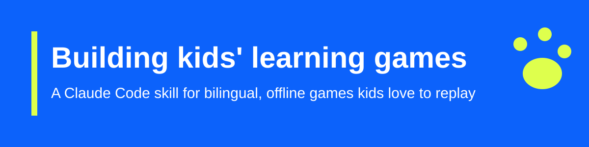

# Building kids' learning games

You want to make a new game for your kids, and you'd like it to be as good as the last one on day one. This skill helps you get there.

It teaches Claude Code how to build games in the **Bruno family**: small, free browser games where zookeeper (or astronaut, or paleontologist) Bruno guides kids aged 6–10 through a topic in English and Spanish. The games install on an iPad, work offline, and keep kids' data on their device.

The skill comes from two real games:

- **Bruno's Zoo** ([play](https://mariotristan.github.io/animals/)): 36 animals, real sounds, quizzes, stickers
- **Planet Explorer** ([play](https://mariotristan.github.io/planets/)): the Sun, eight planets, the Moon, and Pluto

## What you get

- **Settled decisions.** The stack, rules, art style, and privacy choices are already made, so planning a new game takes one conversation instead of ten.
- **Working code to start from.** `templates/` is a full copy of the Zoo's game code and tests, minus the media. Copy it, rename it, and fill in your topic.
- **Fixes for 16 bugs we already hit.** iPad audio, stale offline copies, speech cutting off mid-sentence, fast double taps, and more. Each one has a fix in the templates and, where possible, a test.
- **Repeatable asset pipelines.** Exact commands to find openly licensed sounds, convert artwork, build icons, and keep credits accurate.

## Install

You need [Claude Code](https://claude.com/claude-code).

```bash
git clone git@github.com:mariotristan/kids-learning-games-skill.git
ln -s "$PWD/kids-learning-games-skill/skills/building-kids-learning-games" ~/.claude/skills/building-kids-learning-games
```

Claude Code picks up the skill on its next start.

## Use it

Just ask for a new game in plain words:

> Make another game like the zoo, about bugs and insects, with four habitats.

Claude loads the skill and confirms the family defaults in one message. Then it asks only about what's new for your topic: which subjects, whether art exists for them, and what they sound like.

## What's inside

| Path | What it's for |
|---|---|
| `skills/building-kids-learning-games/SKILL.md` | Defaults, architecture, pitfalls, build order, how to check the work, publishing |
| `skills/building-kids-learning-games/assets.md` | How to source sounds, artwork, button icons, and the app icon |
| `skills/building-kids-learning-games/templates/` | The Zoo's code, tests, and dev scripts, ready to adapt |
| `docs/how-it-works.md` | The game pattern and why each choice was made |
| `docs/testing.md` | How the skill was tested and what changed as a result |

## Principles every game keeps

- **Nobody fails.** A wrong answer gets a kind word and another try.
- **Everything important is spoken.** Early readers can play on their own.
- **Two languages, always.** Every word kids see exists in English and Spanish.
- **Private by design.** No accounts, ads, analytics, or trackers. Progress stays on the device.
- **Credit every creator.** Every sound and picture is openly licensed and credited in the game.

## License

[MIT](LICENSE). Templates include code from Bruno's Zoo (MIT). Artwork and sound licenses are described in each game's own credits.
